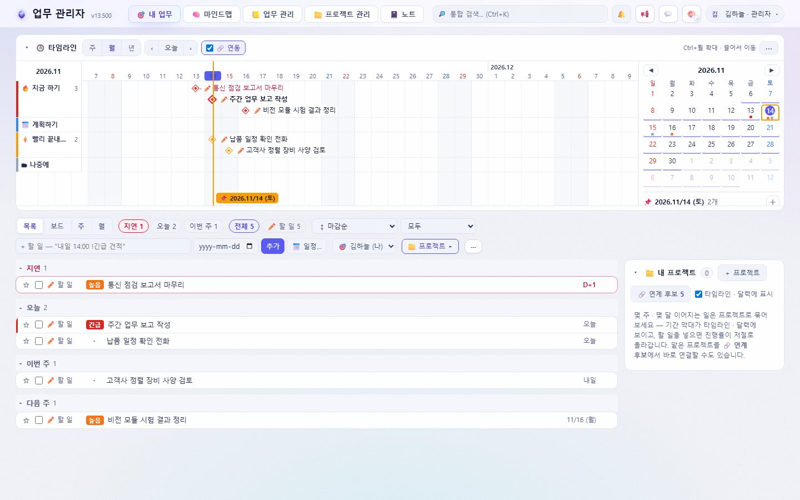
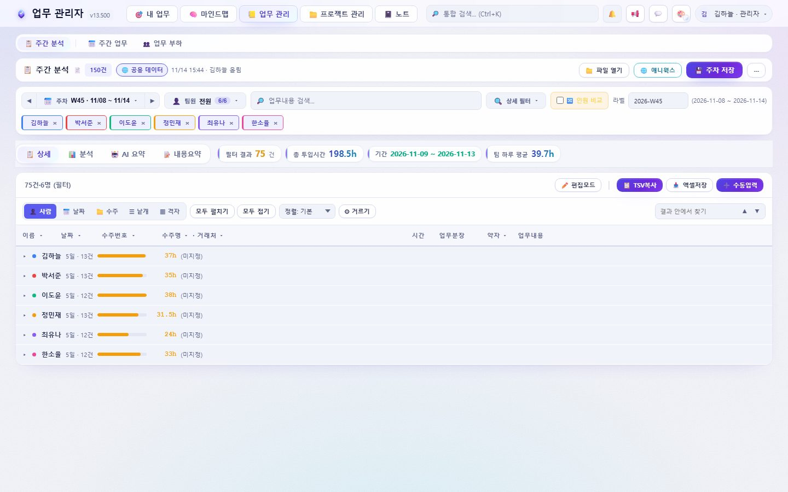
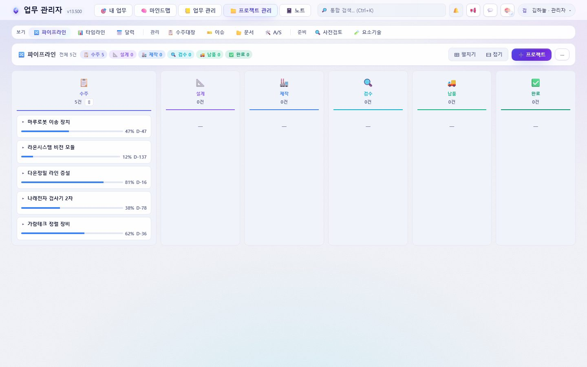
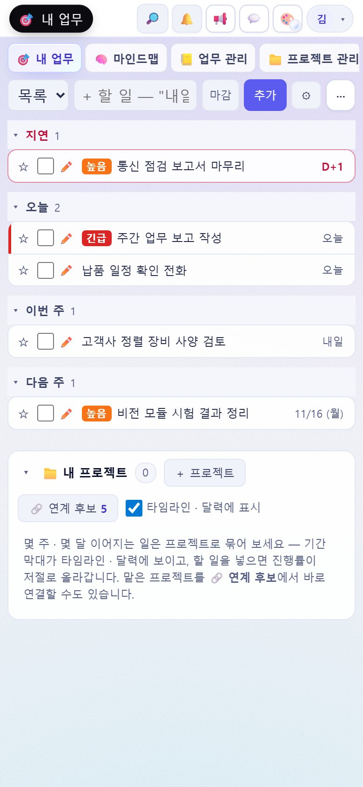
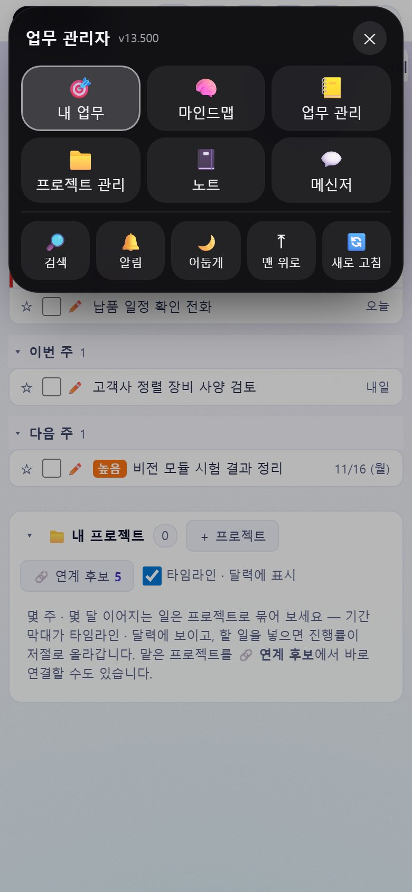

# 업무 관리자 — 배포판

| | |
|---|---|
| ⬇ **PC 앱 (Windows)** | [`desktop/`](desktop/) 폴더의 `WorkManager-Setup-x.y.z.exe` — 받아서 실행 |
| 📱 **휴대폰** | 업무 관리자 주소를 Safari(공유 → 홈 화면에 추가) · Chrome(⋮ → 앱 설치)으로 |
| 📖 **소개 · 사용 설명서** | 서버의 `/download` 페이지 (원본 [`site/index.html`](site/index.html)) |

| 업무 관리 | 프로젝트 관리 | 메신저 |
|---|---|---|
|  |  |  |

| 휴대폰 내 업무 | 아일랜드 빠른 메뉴 | 휴대폰 메신저 |
|---|---|---|
|  |  |  |

(화면의 사람 · 회사 · 업무는 모두 가상의 예시입니다)

## 폴더
- `desktop/` — PC 앱 설치 파일 · `latest.yml` (서버가 `/desktop-release/` 로 내려 주는 **자동 업데이트 원본**). 배포 순서는 [`desktop/README.md`](desktop/README.md)
- `site/` — 소개 · 내려받기 · 사용 설명서 페이지와 화면 (서버 `/download`). 화면 다시 찍기: `bash test/e2e/run.sh zz-release-shots.js`

## 새 버전이 나오면
- 웹: 서버 배포 → 켜 둔 화면에 ⬆ 띠 · 알림을 켠 휴대폰/브라우저에 푸시 알림 · PC 앱은 윈도우 알림
- PC 앱: `desktop/` 에 새 설치 파일을 커밋 · 푸시 → 다음 새로 고침 때 저절로 설치
